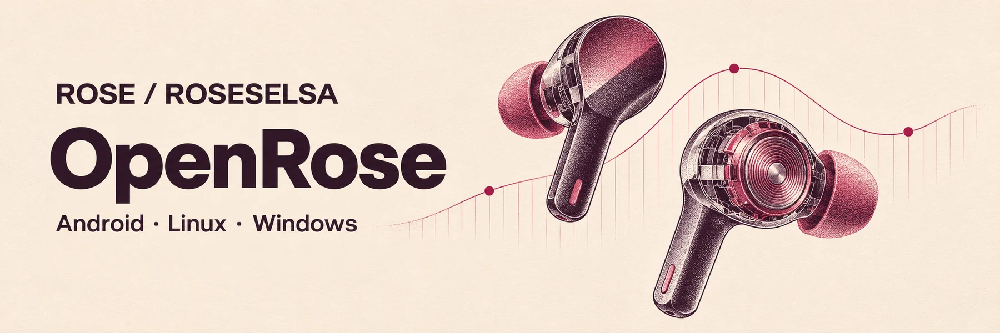

# 

[](https://github.com/DOHEX/OpenRose/actions/workflows/ci.yml)
[](https://github.com/DOHEX/OpenRose/releases)
[](LICENSE)

[简体中文](README.md) | **English** · [**Documentation**](https://dohex.github.io/OpenRose/en/)

OpenRose is an unofficial control app for ROSE / ROSESELSA (弱水时砂) earphones and a replacement for the official RoseLink app for everyday settings. On HyperOS it can also plug the earphones into the system island, focus notifications, and Fusion Device Center. The UI comes in two styles, Miuix and Material 3, and runs on Android and on Linux and Windows desktops (see [Platform support](https://dohex.github.io/OpenRose/en/reference/platforms/)).

> [!WARNING]
> OpenRose is under active development and most features have not been fully tested on real hardware. See [Supported earphones](#supported-earphones) for details, and please [report problems](#feedback).

## Supported earphones

| Earphones | Connection | Status |
| --- | --- | --- |
| EarFree i5 (EarFeel i5) | BLE | Hardware reads verified. Android ordinary and module control both confirmed transparency and wind-noise mode writes by device read-back. Other setting writes await verification |
| EarFeel i7 | BLE or SPP | Offline tests only; not tested on a real device |
| BudsFeel MK2 | BLE or SPP | Not tested on a real device |
| OpenFeel MK2 | BLE or SPP | Not tested on a real device |
| Swift 2 | BLE or SPP | Not tested on a real device |
| Jasmine | BLE or SPP | Not tested on a real device |
| EarFree i3 | BLE | Not tested on a real device |
| HeadFeel (HeadFree) | BLE or SPP | Single-unit battery; not tested on a real device |
| AGATE, AGATE X, CERAMICS | BLE | Not tested on a real device |
| CERAMICS-X | BLE | Not tested on a real device |
| CERAMICS-X 7034, EXPLORER | BLE or SPP | Not tested on a real device |
| BudsFree i, SWIFT | BLE | Not tested on a real device |
| Cambrian, OpenFun, SportFeel (SportFree) | BLE or SPP | Not tested on a real device |
| OpenFeel (OpenFree, LDAC / LHDC / dual-codec branches) | BLE | Not tested on a real device |
| CERAMICS-MK2 (standard, 8912F, 5736) | BLE or SPP | Not tested on a real device |
| CERAMICS-U (standard, HSC-2710) | BLE or SPP | Not tested on a real device |
| FURINA, Zircon, Coral | BLE or SPP | Not tested on a real device |
| SpeakFeel (speakfree), SPEAKFEEL (speakfeel2) | BLE or SPP | Not tested on a real device |
| Astro X, OpenFeel L, FIRST ANGEL, MOKA | BLE or SPP | Not tested on a real device |
| Hyacinth, Opal, Mirror, KY01 | BLE or SPP | Not tested on a real device |
| Luminous Patamon, Tailmon, Gabumon, Agumon | BLE or SPP | Not tested on a real device |
| BudsFeel AE Neo, EarFeel iE Neo, EarFeel iE2 | BLE or SPP | Not tested on a real device |
| SportFeel 8912F | BLE or SPP | Not tested on a real device |
| Cambrian S, OpenLink | BLE or SPP | Not tested on a real device |
| Magician | BLE or SPP | Not tested on a real device |

OpenRose covers all 48 Bluetooth earphone configurations in RoseLink 3.8.6 and retains Magician from 3.8.0. OpenFeel has three codec variants and OpenFun has two touch-control variants, bringing the OpenRose total to 52 profiles. See [Supported earphones](https://dohex.github.io/OpenRose/en/reference/supported-earphones/) for how models are identified, and the [model adaptation evidence ledger](docs/protocols/model-adaptation-ledger.md) (Chinese) for each model's sources.

## Features

- **Earphone controls**: battery and firmware version, ANC and transparency levels, game mode, EQ, touch bindings, wear detection, multipoint, and more; what you see depends on the model and firmware
- Open the **Android quick panel** from a Quick Settings tile or the focus notification to check battery levels, change noise or game mode, or tap the equalizer row to choose an EQ preset. The panel stays open after you choose a preset.
- **Two UI styles**: Miuix and Material 3 Expressive; switching keeps the earphones connected
- **Background control**: keeps the control connection after you close the app and restores it after the process is reclaimed or the phone restarts; no root needed
- **HyperOS integration**: through the Xposed module, the system island, focus notifications, and Fusion Device Center; the system Bluetooth process can control the earphones directly
- **Xiaomi HyperConnect** lets you move the earphones between two HyperOS devices on the same Xiaomi account. Enable module control on both and use Fusion Device Center to move the connection. This feature is experimental and awaits verification on two HyperOS devices.
- **OpenRose over LAN** connects a phone running module control to a Linux or Windows PC on the same local network for all recognized ROSE models. Once paired, the headset card in My Earphones, the desktop tray, and the phone quick panel shows the current audio source when known. Adjust noise mode, ANC and transparency levels, EQ presets, and game mode remotely (availability depends on model capabilities), or use the card to move the audio connection to the phone or computer you are using. Transfers in both directions and remote noise control have been tested with the i5 on Xiaomi 14 and Linux; other models, newly added remote settings, and Windows hardware testing are pending.
- **Local control**: controls earphones over Bluetooth without an account.

See [Features](https://dohex.github.io/OpenRose/en/reference/features/) for the full list.

## Getting started

Requires Android 8.0 (API 26) or later. The app UI is currently Chinese only.

1. Download the APK from [Releases](https://github.com/DOHEX/OpenRose/releases); development builds are available as artifacts on [GitHub Actions](https://github.com/DOHEX/OpenRose/actions/workflows/ci.yml) (GitHub sign-in required).
2. Pair and connect the earphones in the **system Bluetooth settings** first. OpenRose does not handle audio pairing.
3. Open OpenRose and grant the Bluetooth permission. The control connection opens automatically once the earphones connect to system audio.

See [Getting started](https://dohex.github.io/OpenRose/en/guides/getting-started/) for the full steps.

## Documentation

- [Background control](https://dohex.github.io/OpenRose/en/guides/background-control/)
- [HyperOS integration](https://dohex.github.io/OpenRose/en/guides/hyperos-integration/): requirements, control way, headset circulation, and known limitations
- [Desktop](https://dohex.github.io/OpenRose/en/guides/desktop/): Windows and Linux installation, handoff pairing, tray, and window rules
- [Troubleshooting](https://dohex.github.io/OpenRose/en/guides/troubleshooting/)
- [Permissions and privacy](https://dohex.github.io/OpenRose/en/reference/permissions/)

## Building from source

Requires JDK 21 and the Android SDK (Platform 37, Build Tools 37.0.0; set `ANDROID_HOME` or `sdk.dir` in `local.properties`). Building the Windows desktop app also requires stable Rust with the MSVC toolchain and Visual Studio C++ Build Tools. On Windows, replace `./gradlew` with `.\gradlew.bat`. For the development environment, checks, and commit conventions, see [CONTRIBUTING.md](CONTRIBUTING.md) (Chinese).

```bash
./gradlew :androidApp:assembleDebug   # Android debug APK
./gradlew :desktopApp:run             # run the desktop app
./gradlew offlineCheck                # all checks that need no earphone hardware
```

Developer docs (mostly Chinese): [protocol implementation](docs/protocols.md), [protocol research](docs/protocols/), [architecture decisions](docs/adr/), [glossary](GLOSSARY.md).

## Feedback

Report bugs and request features in [GitHub Issues](https://github.com/DOHEX/OpenRose/issues). See [Feedback](https://dohex.github.io/OpenRose/en/guides/feedback/) for what to include.

## License

OpenRose is licensed under [GPL-3.0-or-later](LICENSE).

## Acknowledgements

- [OppoPods](https://github.com/1812z/OppoPods) — the HyperOS integration draws on its approach
- [Miuix](https://github.com/compose-miuix-ui/miuix) — UI library behind the Miuix style
- [Backdrop](https://github.com/Kyant0/AndroidLiquidGlass) — liquid glass effects behind the Miuix liquid glass bottom bar
- [LSPosed](https://github.com/LSPosed/LSPosed) — Xposed framework that runs the system-integration module
- [libxposed API](https://github.com/libxposed/api) — Xposed API used by the module
- [Compose Multiplatform](https://github.com/JetBrains/compose-multiplatform) — cross-platform UI framework
