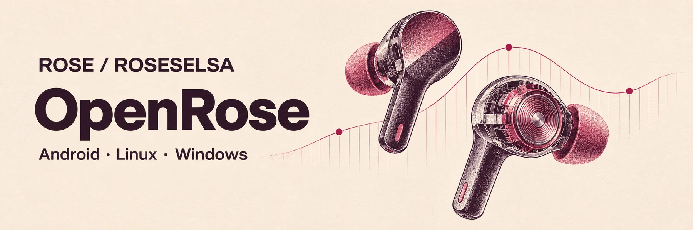

# 

[](https://github.com/DOHEX/OpenRose/actions/workflows/ci.yml)
[](https://github.com/DOHEX/OpenRose/releases)
[](LICENSE)

**简体中文** | [English](README.en.md) · [**使用文档**](https://dohex.github.io/OpenRose/)

OpenRose 是 ROSE / ROSESELSA（弱水时砂）耳机的第三方控制客户端，可以替代官方 RoseLink 完成日常设置。在 HyperOS 上，它还能把耳机接入超级岛、焦点通知和融合设备中心。界面提供 Miuix 和 Material 3 两种风格，支持 Android，以及 Linux 和 Windows 桌面（见[平台支持](https://dohex.github.io/OpenRose/reference/platforms/)）。

> [!WARNING]
> 项目仍在开发中，大部分功能尚未在真机上完整验证，详见[支持的耳机](#支持的耳机)。遇到问题欢迎[反馈](#反馈)。

## 支持的耳机

| 耳机 | 连接 | 状态 |
| --- | --- | --- |
| EarFree i5（EarFeel i5） | BLE | 真机读取已验证。Android 普通与模块控制均已验证通透、抗风噪写入和设备回读；其他设置写入待验证 |
| EarFeel i7 | BLE 或 SPP | 仅有离线测试，未经真机验证 |
| BudsFeel MK2 | BLE 或 SPP | 未经真机验证 |
| OpenFeel MK2 | BLE 或 SPP | 未经真机验证 |
| 踏浪 Swift 2 | BLE 或 SPP | 未经真机验证 |
| Jasmine | BLE 或 SPP | 未经真机验证 |
| EarFree i3 | BLE | 未经真机验证 |
| HeadFeel（HeadFree） | BLE 或 SPP | 单体电量；未经真机验证 |
| AGATE、AGATE X、CERAMICS | BLE | 未经真机验证 |
| CERAMICS-X | BLE | 未经真机验证 |
| CERAMICS-X 7034、EXPLORER | BLE 或 SPP | 未经真机验证 |
| BudsFree i、SWIFT | BLE | 未经真机验证 |
| Cambrian、OpenFun、SportFeel（SportFree） | BLE 或 SPP | 未经真机验证 |
| OpenFeel（OpenFree，LDAC / LHDC / 双编码分支） | BLE | 未经真机验证 |
| CERAMICS-MK2（标准、8912F、5736） | BLE 或 SPP | 未经真机验证 |
| CERAMICS-U（标准、HSC-2710） | BLE 或 SPP | 未经真机验证 |
| FURINA、Zircon、Coral | BLE 或 SPP | 未经真机验证 |
| SpeakFeel（speakfree）、SPEAKFEEL（speakfeel2） | BLE 或 SPP | 未经真机验证 |
| Astro X、OpenFeel L、FIRST ANGEL、MOKA | BLE 或 SPP | 未经真机验证 |
| Hyacinth、Opal、Mirror、KY01 | BLE 或 SPP | 未经真机验证 |
| Luminous Patamon、Tailmon、Gabumon、Agumon | BLE 或 SPP | 未经真机验证 |
| BudsFeel AE Neo、EarFeel iE Neo、EarFeel iE2 | BLE 或 SPP | 未经真机验证 |
| SportFeel 8912F | BLE 或 SPP | 未经真机验证 |
| Cambrian S、OpenLink | BLE 或 SPP | 未经真机验证 |
| Magician | BLE 或 SPP | 未经真机验证 |

OpenRose 已接入 RoseLink 3.8.6 的全部 48 个蓝牙耳机配置，并保留 3.8.0 的 Magician。OpenFeel 的三个编码分支及 OpenFun 的两个触控分支分别适配，共 52 个 OpenRose 型号配置。识别规则与各型号的适配依据见[支持的耳机](https://dohex.github.io/OpenRose/reference/supported-earphones/)和[型号适配证据账本](docs/protocols/model-adaptation-ledger.md)。

## 功能

- **耳机控制**：电量与固件版本、降噪与通透档位、游戏模式、EQ、触控按键、佩戴检测、多点连接等，可用项随型号和固件变化
- 从控制中心磁贴或焦点通知打开 **Android 快捷面板**，即可查看电量、切换降噪与游戏模式，或点按「均衡器」选择 EQ 预设。选完预设后面板保持打开。
- **两种界面风格**：Miuix 与 Material 3 Expressive，切换时不断开耳机
- **后台控制**：关闭界面后保持控制连接，进程被回收或重启后自动恢复，无需 root
- **HyperOS 系统集成**：经 Xposed 模块接入超级岛、焦点通知和融合设备中心，可由系统蓝牙进程直接控制耳机
- **本地运行**：本机通过蓝牙控制耳机，无需账号。流转配对后，手机模块宿主和电脑通过局域网交换耳机状态与操作

完整说明见[功能一览](https://dohex.github.io/OpenRose/reference/features/)。

## 安装

要求 Android 8.0（API 26）及以上。

1. 从 [Releases](https://github.com/DOHEX/OpenRose/releases) 下载 APK；开发版可在 [GitHub Actions](https://github.com/DOHEX/OpenRose/actions/workflows/ci.yml) 的构建产物中下载（需登录 GitHub）。
2. 先在**系统蓝牙设置**里配对并连接耳机，OpenRose 不负责音频配对。
3. 打开 OpenRose 并授予蓝牙权限。耳机连上系统音频后会自动建立控制连接。

详细步骤见[快速开始](https://dohex.github.io/OpenRose/guides/getting-started/)。

## 文档

- [后台控制](https://dohex.github.io/OpenRose/guides/background-control/)
- [HyperOS 系统集成](https://dohex.github.io/OpenRose/guides/hyperos-integration/)：前提条件、控制方式、耳机流转与已知限制
- [Windows 桌面版](https://dohex.github.io/OpenRose/guides/windows-desktop/)：MSI 安装与系统蓝牙配对
- [Linux 桌面版](https://dohex.github.io/OpenRose/guides/linux-desktop/)：安装包、托盘与窗口规则
- [常见问题](https://dohex.github.io/OpenRose/guides/troubleshooting/)
- [权限与隐私](https://dohex.github.io/OpenRose/reference/permissions/)

## 从源码构建

需要 JDK 21 和 Android SDK（Platform 37、Build Tools 37.0.0，设置 `ANDROID_HOME` 或 `local.properties` 的 `sdk.dir`）。构建 Windows 桌面版还需 Rust stable（MSVC 工具链）和 Visual Studio C++ Build Tools。Windows 下把 `./gradlew` 换成 `.\gradlew.bat`。开发环境、各项检查与提交规范见 [CONTRIBUTING.md](CONTRIBUTING.md)。

```bash
./gradlew :androidApp:assembleDebug   # Android 调试 APK
./gradlew :desktopApp:run             # 运行桌面版
./gradlew offlineCheck                # 不依赖耳机硬件的全部检查
```

开发文档：[协议实现说明](docs/protocols.md)、[协议研究](docs/protocols/)、[架构决策记录](docs/adr/)、[术语表](GLOSSARY.md)。

## 反馈

问题和需求请提交到 [GitHub Issues](https://github.com/DOHEX/OpenRose/issues)。需要附带的信息见[反馈问题](https://dohex.github.io/OpenRose/guides/feedback/)。

## 许可

OpenRose 以 [GPL-3.0-or-later](LICENSE) 授权。

## 致谢

- [OppoPods](https://github.com/1812z/OppoPods) — HyperOS 系统集成参考了它的实现思路
- [Miuix](https://github.com/compose-miuix-ui/miuix) — Miuix 界面风格使用的组件库
- [Backdrop](https://github.com/Kyant0/AndroidLiquidGlass) — Miuix 液态玻璃底栏使用的效果库
- [LSPosed](https://github.com/LSPosed/LSPosed) — 运行系统集成模块的 Xposed 框架
- [libxposed API](https://github.com/libxposed/api) — 模块使用的 Xposed API
- [Compose Multiplatform](https://github.com/JetBrains/compose-multiplatform) — 跨平台界面框架
