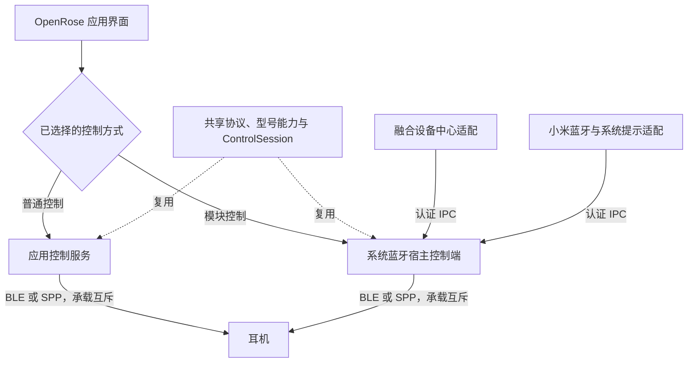

# Android 共享控制核心、双承载与单一会话所有者

OpenRose 必须同时支持免 root 普通控制与可选模块控制。用户报告未打开应用时融合设备中心不能读取电量或调节降噪；源码虽已有应用 Service 的冷启动绑定路径，但尚未确定该故障的具体根因。本次选择让模块控制脱离 OpenRose 应用进程自治，保留普通控制的独立运行能力，而不是继续让所有系统入口依赖应用进程中的会话。

采用一套共享控制核心、两种互斥的 Android 承载：普通控制由 OpenRose 应用承载，模块控制由 `com.android.bluetooth` 承载。同一设备的控制连接、收发队列、真实状态和操作确认只有一个所有者；不新增独立 root 控制进程，也不为两个承载复制协议或状态机。

用户已确认本决策的整体设计及控制会话承载、生命周期、所有权交接与验收约束。此处描述目标架构，工程实现与实机验收结果另行记录。

## 职责与运行关系

- **共享核心**：复用现有型号识别、能力、协议、传输选择、控制状态机与命令确认。i5 仍使用其 BLE 路径，i7 按已有条件选择 BLE 或 SPP；不照搬 OppoPods 的 OPPO RFCOMM 协议。应用中现有的型号控制能力在模块控制下继续通过同一核心提供，不将模块承载缩成仅支持电量和降噪的另一套实现。
- **普通控制承载**：由应用控制服务管理会话生命周期，界面观察并操作该会话。提供用户可启用的后台控制，采用 Android 公开的持续运行和唤起机制，包括适用的 `connectedDevice` 前台服务与伴生设备机制。补齐相应权限、系统关联引导与运行通知；具体组合按 Android 版本及设备验证，不假定单一机制覆盖 Android 8.0+ 的全部场景。
- **模块控制承载**：由系统蓝牙宿主初始化并持有会话，观察系统音频连接，读取已持久化的模块配置。启动、认证引导及运行不能依赖本次启动 OpenRose Activity、创建 OpenRose `Application`、绑定应用内控制 Service 或应用侧发布本次会话凭据。蓝牙调用使用真实宿主 Context、UID 与权限，不冒用应用身份。
- **控制 Interface**：应用和系统入口通过同一控制语义读取状态、查询设备、连接目标、提交设置并观察设备确认结果。蓝牙连接、协议队列、恢复与能力判断集中在会话所有者；界面风格和调用入口不持有另一套会话。
- **系统入口 Adapter**：`com.milink.service` 与 `com.xiaomi.bluetooth` 只消费模块控制的可信状态并提交操作，不创建蓝牙控制客户端。继续沿用系统呈现策略，官方提示仍由小米蓝牙进程调用系统服务。

## 已确认的用户行为

1. **模块自治**：完成首次配置、启用模块并选择模块控制后，本次开机未打开 OpenRose、关闭界面或应用进程被系统回收，融合设备中心仍须读取真实电量并执行可用的降噪操作。
2. **免 root 后台控制**：用户可启用持续后台控制，并接受前台服务方案所需的运行通知。应用未运行时，耳机后续音频连接也应自动唤起并恢复控制；允许必要的一次性系统关联授权与自启动配置。
3. **失效处理**：模块暂时不可用时，显示明确的不可用状态并优先恢复模块会话；不因 IPC 超时、暂时失联或打开界面就自动建立应用控制连接。用户可主动选择普通控制，且接管必须符合下述交接约束。
4. **选择持续有效**：用户切回普通控制后保持该选择；模块恢复不自动切回，下一次切换由用户发起。
5. **普通控制的范围**：提供应用与可选后台控制，暂停模块提供的融合设备中心、系统耳机提示等增强功能。切回模块控制后恢复这些功能；不保留普通控制会话向模块系统入口转发的额外路径。
6. **强停与显式停用**：强行停止主应用结束应用自身的后台控制，已启用的自治模块继续工作。提供明确的停用模块控制入口；不能把关闭应用界面或强停应用等同于停用模块。
7. **开机恢复起点**：两种控制方式均从本次开机首次解锁后，按已保存的控制方式与后台设置恢复；首次解锁后无需再打开 OpenRose。本次目标不包括首次解锁前的自动控制。

## 所有权交接与进程失效

控制方式表示用户意图，不等于当前已经成功建立控制连接。界面区分已选择的方式、所有者是否就绪以及耳机控制连接状态，不能因保存了偏好就显示控制已就绪。

所有者切换须先阻止旧所有者继续连接或发送，关闭其控制连接并使旧请求、订阅和回调失效，再允许新所有者建立连接。释放确认必须属于对应的所有者代际与切换请求；也可使用能证实原所有者进程已结束的证据。仅有 IPC 超时、界面离开或远端状态未知不构成释放证据；无法确认时不接管，并说明切换尚未完成。

用户切换普通控制后，已保存的选择应阻止模块重启或恢复时重新争夺连接。持久化选择、运行中的所有者代际与交接结果须有一致的恢复规则，不能仅凭两边各自的进程内单例或可过期缓存决定所有权。进程重启、模块热重载、应用重开、重复切换与中途退出都必须遵守同一约束。

正常切换只释放和重建 OpenRose 控制连接，不主动改变系统音频连接。重启系统集成作用域仍是独立的用户操作，不在自动恢复或普通切换中隐式执行。

## IPC 与状态约束

- 复用既有 AIDL、身份校验、会话标识、旧回调隔离与诊断模式；调整控制所有者与客户端的方向及认证引导，清除仅适用于“应用必为所有者”的路径。发现控制端与获得控制授权是不同步骤，不能把收到 Binder 或广播视为已通过认证。
- 所有跨进程读取、命令及所有权变更均校验调用者、设备、所有者代际和会话。保持单一授权及命令路径；不直接复制上游广播载荷作为可信控制入口。
- 消费者失联后撤销自身展示或显示不可用，不继续把过期电量、降噪模式或已失效能力当作当前状态。新会话重新读取真实状态；设置成功仍以耳机回包或重读确认为准。
- 普通控制期间撤销模块自有的展示、状态发布与控制入口，不影响其他耳机或系统的正常行为。后台控制的必要运行通知与已有超级岛／焦点通知呈现设置分别管理。

## 与既有决策的关系

本决策具体化 [ADR 0002](0002-shared-kotlin-core-and-platform-adapters.md) 的“一个权威控制会话”，将应用固定承载改为按控制方式选择承载；共享核心、型号证据与传输选择不变。

继续遵循 [ADR 0005](0005-miuix-nav-and-audio-bound-control-lifecycle.md)：系统音频连接驱动自动建立控制，音频断开后释放自动控制连接，并保留既有手动控制能力；本次补充未运行时唤起与开机恢复。应用界面、路由或风格变化不改变控制所有者。

[ADR 0003](0003-official-island-and-headset-notifications.md) 的通知呈现与设备确认约束、[ADR 0004](0004-official-prompts-without-system-server-hooks.md) 的三个系统集成作用域及不 Hook `system_server` 的决定继续有效。普通／模块控制方式与超级岛的官方／模块呈现模式是不同设置。

拒绝继续以应用进程作为模块控制的必需承载，因为它不满足已确认的模块自治目标；也拒绝每个 Hook 宿主各建连接。独立 root 控制进程增加部署、Android 蓝牙接入与生命周期成本，当前没有必要为此新增一套运行环境。代价是需要维护两种承载及其交接，但协议与控制状态机只维护一套。

## 实施验收与当前证据

验收须分别覆盖普通控制、免 root 后台唤起和模块控制，不能以编译、离线测试或一次打开应用后的连接成功替代。

- 模块控制：首次解锁后，不打开主应用即可完成真实电量读取、融合设备中心降噪操作及耳机确认；主应用关闭、进程回收与强停均不破坏自治目标。普通控制无需模块也可完成已有型号控制功能。
- 普通后台控制：关闭界面后继续读取状态；应用进程消失或设备重启后，在首次解锁与后续耳机音频连接中自动恢复。验证所需系统关联、权限、自启动设置、运行通知及用户停用行为。
- 交接与失效：覆盖两方向切换、模块短暂失联、旧所有者无法确认释放、模块恢复、应用重开、宿主重启及热重载；观察到单一实际控制连接与发送路径，旧会话不能影响新会话。
- 系统入口：普通控制时模块增强功能暂停；模块控制时应用、融合设备中心与通知观察同一真实状态。断开、停用及切换后撤销所属展示，保持既有通知与超级岛设置含义。

已实施的前置步骤（#75）：应用界面、添加耳机流程、系统卡片跳转与桥接消费者都经由 `core` 中的统一控制入口 `ControlRuntime` 读取状态、连接指定耳机、断开并提交设置，`ControlSession` 不再对 `core` 之外可见；承载仍是应用进程，尚未提供模块控制承载、所有权交接与后台唤起，也未做实机验收。

已实施的步骤（#76）：普通控制的后台控制意图（`backgroundControlEnabled`，默认关闭、缺失时不开启）由用户设置持久化；`ControlService`（`connectedDevice` 前台服务，不导出，非粘性）在界面可见的入口（开关、打开应用、授权返回）启动，保持应用进程内的唯一控制运行时，关闭界面或移除任务不新建会话。服务只观察该运行时、更新必要运行通知并在意图被关闭时结束自身，不创建、替换或断开会话，也不触碰系统音频。会话仍由应用进程创建，服务承载的是其后台生命周期，尚未把会话创建迁入服务。服务状态、通知可见性与蓝牙权限作为平台事实进入控制状态，设置页由此区分“已保存意图”与“运行中／被阻止（原因）”。进程消失后的唤起与开机恢复属于后续票据；上述行为未在真机上观察。

首验仍为 i5 + 小米 14（HyperOS 4）；i7、HyperOS 3 及其他 Android 版本结果分别记录，不把上游实现当作 OpenRose 实测。当前只有源码调查与设备只读状态观察，尚未实施该架构，也尚未完成上述行为验收。证据及九项访谈决策见 [生命周期研究](../research/android-control-session-lifecycle.md)。
