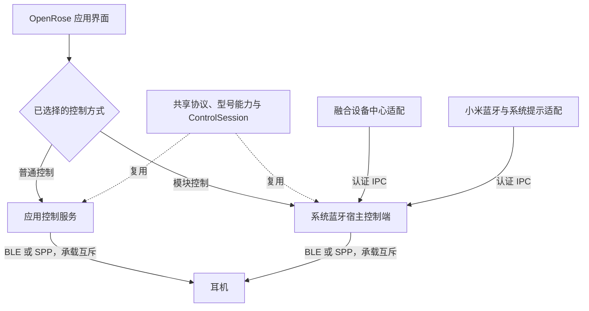

# Android 共享控制核心、双承载与单一会话所有者

OpenRose 必须同时支持免 root 普通控制与可选模块控制。用户报告未打开应用时融合设备中心不能读取电量或调节降噪；源码虽已有应用 Service 的冷启动绑定路径，但尚未确定该故障的具体根因。本次选择让模块控制脱离 OpenRose 应用进程自治，保留普通控制的独立运行能力，而不是继续让所有系统入口依赖应用进程中的会话。

采用一套共享控制核心、两种互斥的 Android 承载：普通控制由 OpenRose 应用承载，模块控制由 `com.android.bluetooth` 承载。同一设备的控制连接、收发队列、真实状态和操作确认只有一个所有者；不新增独立 root 控制进程，也不为两个承载复制协议或状态机。

用户已确认本决策的整体设计及控制会话承载、生命周期、所有权交接与验收约束。此处描述目标架构，工程实现与实机验收结果另行记录。

## 职责与运行关系

- **共享核心**：复用现有型号识别、能力、协议、传输选择、控制状态机与命令确认。i5 仍使用其 BLE 路径，i7 按已有条件选择 BLE 或 SPP；不照搬 OppoPods 的 OPPO RFCOMM 协议。应用中现有的型号控制能力在模块控制下继续通过同一核心提供，不将模块承载缩成仅支持电量和降噪的另一套实现。
- **普通控制承载**：由应用控制服务管理会话生命周期，界面观察并操作该会话。提供用户可启用的后台控制，采用 Android 公开的持续运行和唤起机制，包括适用的 `connectedDevice` 前台服务与伴生设备机制。补齐相应权限、系统关联引导与运行通知；具体组合按 Android 版本及设备验证，不假定单一机制覆盖 Android 8.0+ 的全部场景。
- **模块控制承载**：由系统蓝牙宿主初始化并持有会话，观察系统音频连接，读取已持久化的模块配置。启动、认证引导及运行不能依赖本次启动 OpenRose Activity、创建 OpenRose `Application`、绑定应用内控制 Service 或应用侧发布本次会话凭据。蓝牙调用使用真实宿主 Context、UID 与权限，不冒用应用身份。
- **控制 Interface**：应用和系统入口通过同一控制语义读取状态、查询设备、连接目标、提交设置并观察设备确认结果。蓝牙连接、协议队列、恢复与能力判断集中在会话所有者；界面风格和调用入口不持有另一套会话。
- **系统入口 Adapter**：`com.milink.service` 与 `com.xiaomi.bluetooth` 只消费模块控制的可信状态并提交操作，不创建蓝牙控制客户端。继续沿用系统呈现策略，官方提示仍由小米蓝牙进程调用系统服务。

## 已确认的用户行为

1. **模块自治**：完成首次配置、启用模块并选择模块控制后，本次开机未打开 OpenRose、关闭界面或应用进程被系统回收，融合设备中心仍须读取真实电量并执行可用的降噪操作。
2. **免 root 后台控制**：用户可启用持续后台控制，并接受前台服务方案所需的运行通知。应用未运行时，耳机后续音频连接也应自动唤起并恢复控制；允许必要的一次性系统关联授权与自启动配置。
3. **失效处理**：模块暂时不可用时，显示明确的不可用状态并优先恢复模块会话；不因 IPC 超时、暂时失联或打开界面就自动建立应用控制连接。用户可主动选择普通控制，且接管必须符合下述交接约束。
4. **选择持续有效**：用户切回普通控制后保持该选择；模块恢复不自动切回，下一次切换由用户发起。
5. **普通控制的范围**：提供应用与可选后台控制，暂停模块提供的融合设备中心、系统耳机提示等增强功能。切回模块控制后恢复这些功能；不保留普通控制会话向模块系统入口转发的额外路径。
6. **强停与不提供“停用”**：强行停止主应用结束应用自身的后台控制，已启用的自治模块继续工作；不能把关闭应用界面或强停应用等同于停用模块。不提供单独的“停用模块控制”入口，也没有“已停用”的保存状态，要让模块不再控制，选择普通控制。（2026-11 修订：原要求提供明确的停用入口。该状态只额外保证 OpenRose 不持有任何控制连接，价值低于它带来的第三种所有者状态与相应分支，且功能尚未发布，故移除。）
7. **开机恢复起点**：两种控制方式均从本次开机首次解锁后，按已保存的控制方式与后台设置恢复；首次解锁后无需再打开 OpenRose。本次目标不包括首次解锁前的自动控制。

## 所有权交接与进程失效

控制方式表示用户意图，不等于当前已经成功建立控制连接。界面区分已选择的方式、所有者是否就绪以及耳机控制连接状态，不能因保存了偏好就显示控制已就绪。

所有者切换须先阻止旧所有者继续连接或发送，关闭其控制连接并使旧请求、订阅和回调失效，再允许新所有者建立连接。释放确认必须属于对应的所有者代际与切换请求；也可使用能证实原所有者进程已结束的证据。仅有 IPC 超时、界面离开或远端状态未知不构成释放证据；无法确认时不接管，并说明切换尚未完成。

用户切换普通控制后，已保存的选择应阻止模块重启或恢复时重新争夺连接。持久化选择、运行中的所有者代际与交接结果须有一致的恢复规则，不能仅凭两边各自的进程内单例或可过期缓存决定所有权。进程重启、模块热重载、应用重开、重复切换与中途退出都必须遵守同一约束。

正常切换只释放和重建 OpenRose 控制连接，不主动改变系统音频连接。重启系统集成作用域仍是独立的用户操作，不在自动恢复或普通切换中隐式执行。

## IPC 与状态约束

- 复用既有 AIDL、身份校验、会话标识、旧回调隔离与诊断模式；调整控制所有者与客户端的方向及认证引导，清除仅适用于“应用必为所有者”的路径。发现控制端与获得控制授权是不同步骤，不能把收到 Binder 或广播视为已通过认证。
- 所有跨进程读取、命令及所有权变更均校验调用者、设备、所有者代际和会话。保持单一授权及命令路径；不直接复制上游广播载荷作为可信控制入口。
- 消费者失联后撤销自身展示或显示不可用，不继续把过期电量、降噪模式或已失效能力当作当前状态。新会话重新读取真实状态；设置成功仍以耳机回包或重读确认为准。
- 普通控制期间撤销模块自有的展示、状态发布与控制入口，不影响其他耳机或系统的正常行为。后台控制的必要运行通知与已有超级岛／焦点通知呈现设置分别管理。
- （2026-11 补充）**两种纪元不可混用**：`AuthenticatedBridgeClient` 运行在目标进程中，是模块宿主唯一控制会话的消费者。它绑定 `com.android.bluetooth` 中已有的导出服务来发现端点，由宿主按 Binder 调用者的 uid 授权，自身不持有凭据，也从不创建 `ControlSession` 或传输。只有在宿主已授权该客户端、确认了当前所有者代际、并确认了这一次读取之后，才调用快照回调。`open` 回复中的 `BridgeWire.HOST_EPOCH` 是宿主实例标识，只用于诊断；`currentSession` 报告的才是当前所有者代际，之后每个请求都携带它，每个快照都回显它。
- （2026-11 补充）**调用者角色**：`AndroidCallerAuthority` 只根据已验证的 Binder uid、pid 以及拥有该 uid 的包来确定角色（`ClientRole`），从不采信载荷中的声明。调用者关于自身的说法（包、进程、解析结果）都不能提升角色，应用也不需要其进程内的任何代码配合。`com.xiaomi.bluetooth` 与宿主 `com.android.bluetooth` 共享 `android.uid.bluetooth`（uid 1002），而其他进程也可能共享这个 uid，所以仅凭 uid 分不清宿主自己的展示代码与小米蓝牙进程，要靠 pid 区分。`HOST_PRESENTATION` 是宿主进程内模块自己的展示代码，按宿主的 uid 与 pid 识别；其他角色是按 uid 与包验证的其他进程。
- （2026-11 补充）**在 Binder 线程上授权**：`HostEndpoint` 在传入请求的 Binder 线程上完成授权；之后的系统调用必须以蓝牙宿主的身份执行（如流转命令的 `circulationResponse`）。
- （2026-11 补充）**宿主配置读取失败**：框架不可用或读取失败时，`ModuleHostRuntime.readConfiguration` 让最后一次确认的配置继续生效，直到下一次尝试。
- （2026-11 补充）**不可取消的 transact**：应用侧的 `BinderCalls` 中，取消 Binder 等待会让调用方不再等待，但已阻塞的 transact 在宿主回复前仍占用它的并发槽位。
- （2026-11 补充）**通知按钮接收器**：在 API 33 之前，`PresentationActions` 注册的接收器由特权权限、包、随机 action 与 token 共同保护。

## 所有权交接、持久化与宿主租约的实现约束（2026-11 补充）

- **首次解锁前没有所有者**：Android 的凭据保护存储只在首次解锁后才存在，在此之前没有任何所有者持有会话。`SwitchingControlRuntime.onUserUnlocked` 收到用户已保存的设置，由其中保存的控制方式决定启动哪个所有者。
- **会话 id 按所有者实例分段**：每个普通会话与每个模块所有者都从各自的起点递增（`SessionIdBase`：普通会话为序号左移 32 位，模块再置第 62 位）。因此从某个所有者实例取得的 `SessionReference`，永远不会等于指向另一个实例的引用，无论对方是下一个普通会话，还是另一种控制方式。
- **缓存进程不响应音频**：平台拒绝关闭最后一个连接句柄时，被缓存的进程不得响应音频连接。最后一份持有释放后，`SwitchingControlRuntime` 按 `retryMillis` 反复重试 `finishIdleRelease`，直到关闭成功。
- **先发布，后取证**：之前的进程可能已写入本地记录，却在框架确认前退出。因此 `ModuleRelease.releaseModule` 在请求释放证明之前先 `publishSelection()`，避免重启后的宿主在当前实例提供证明之后重新取得控制。证明取得后若保存失败，证明此刻依然成立；重启后宿主只需再确认一次。
- **发布失败时回滚并再发布一次**：`OwnerRecordCodec.save` 先写入记录，若变更涉及模块控制再发布。发布失败时恢复为先前的记录，并再发布一次，因为一次并发的发布可能已把被拒绝的选择带了出去。
- **释放回执的效力**：`ModuleControlHost` 确认释放（`confirmRelease`）后保持释放状态，不被滞后的选择推翻，直到出现更新的显式获取。释放回执使此前所有应用租约上仍在途的获取一律失效（`releaseEpoch` 递增后，`acquire` 拒绝更早的租约）。
- **一个进程一份租约**：宿主端点在 `open` 时替换同一进程的旧租约，所以 `ModuleControlClient` 的操作共用观察者的绑定，包括正在进行的发现。只有停止后的释放需要单独的临时租约。
- **以探测判断宿主是否存活**：帧只在设备状态变化时到达，帧的静默不能证明任何事。`ModuleControlClient` 每 `probeIntervalMillis`（5000 ms）调用一次 `HostConnection.status`。宿主停止应答时撤回读数；恢复应答后重新订阅帧，所以停顿前发布的内容不会被当作当前状态显示。
- **交接后本地会话不再连接**：`ControlRuntime.release` 为交接释放所有者。成功退役的本地会话再也不会打开控制连接。
- **普通控制的后台唤起**：各 Android 版本的唤起机制分层与可验证的前置条件见 [ADR 0022](0022-ordinary-control-background-wake.md)。

## 与既有决策的关系

本决策具体化 [ADR 0002](0002-shared-kotlin-core-and-platform-adapters.md) 的“一个权威控制会话”，将应用固定承载改为按控制方式选择承载；共享核心、型号证据与传输选择不变。

继续遵循 [ADR 0005](0005-miuix-nav-and-audio-bound-control-lifecycle.md)：系统音频连接驱动自动建立控制，音频断开后释放自动控制连接，并保留既有手动控制能力；本次补充未运行时唤起与开机恢复。应用界面、路由或风格变化不改变控制所有者。

[ADR 0003](0003-official-island-and-headset-notifications.md) 的通知呈现与设备确认约束、[ADR 0004](0004-official-prompts-without-system-server-hooks.md) 的三个系统集成作用域及不 Hook `system_server` 的决定继续有效。普通／模块控制方式与超级岛的官方／模块呈现模式是不同设置。

拒绝继续以应用进程作为模块控制的必需承载，因为它不满足已确认的模块自治目标；也拒绝每个 Hook 宿主各建连接。独立 root 控制进程增加部署、Android 蓝牙接入与生命周期成本，当前没有必要为此新增一套运行环境。代价是需要维护两种承载及其交接，但协议与控制状态机只维护一套。

（2026-11 补注：[ADR 0012](0012-shared-multiplatform-architecture.md) 将 `SwitchingControlRuntime`、`ModuleControlHost`、连接提示判定及其余 Android 集成逻辑移出 `core`，归入 `:androidIntegration`；系统入口改经集成层核对会话引用后调用同一控制入口。本决策的承载、所有权与交接约束不变；下文实施记录中的 `core` 位置描述的是迁移前的代码。）

（2026-11 补注：[ADR 0017](0017-headset-circulation.md) 引入耳机流转，用户发起时 OpenRose 会让出或接入系统音频连接。上文“正常切换只释放和重建 OpenRose 控制连接，不主动改变系统音频连接”针对控制方式交接，仍然成立；耳机流转不改变所有者，控制连接按 ADR 0005 随音频连接迁移。目标设备按已配对记录回答身份类查询的做法见 0017，状态类查询仍只来自当前会话。）

## 实施验收与当前证据

验收须分别覆盖普通控制、免 root 后台唤起和模块控制，不能以编译、离线测试或一次打开应用后的连接成功替代。

- 模块控制：首次解锁后，不打开主应用即可完成真实电量读取、融合设备中心降噪操作及耳机确认；主应用关闭、进程回收与强停均不破坏自治目标。普通控制无需模块也可完成已有型号控制功能。
- 普通后台控制：关闭界面后继续读取状态；应用进程消失或设备重启后，在首次解锁与后续耳机音频连接中自动恢复。验证所需系统关联、权限、自启动设置、运行通知及用户停用行为。
- 交接与失效：覆盖两方向切换、模块短暂失联、旧所有者无法确认释放、模块恢复、应用重开、宿主重启及热重载；观察到单一实际控制连接与发送路径，旧会话不能影响新会话。
- 系统入口：普通控制时模块增强功能暂停；模块控制时应用、融合设备中心与通知观察同一真实状态。断开、停用及切换后撤销所属展示，保持既有通知与超级岛设置含义。

已实施的前置步骤（#75）：应用界面、添加耳机流程、系统卡片跳转与桥接消费者都经由 `core` 中的统一控制入口 `ControlRuntime` 读取状态、连接指定耳机、断开并提交设置，`ControlSession` 不再对 `core` 之外可见；承载仍是应用进程，尚未提供模块控制承载、所有权交接与后台唤起，也未做实机验收。

已实施的步骤（#76）：普通控制的后台控制意图（`backgroundControlEnabled`，默认关闭、缺失时不开启）由用户设置持久化；`ControlService`（`connectedDevice` 前台服务，不导出，非粘性）在界面可见的入口（开关、打开应用、授权返回）启动。普通会话由统一运行时上的“持有”界定生命周期：界面可见（Activity 已启动，重建有短暂宽限）与 `ControlService` 各持有一份，首次持有时才创建会话（仅在已选普通控制且用户已解锁时），最后一份释放时结束会话并关闭控制连接，不触碰系统音频；因此后台控制关闭时，界面离开后被缓存的进程不再保留控制连接或响应音频连接，开启时服务持有使连接跨界面关闭与重开保持不变；重复持有不会产生第二个会话，模块控制从不创建普通会话；唤起路径（开机、音频连接、设备存在）只启动该服务，由服务持有会话。服务只观察该运行时、更新必要运行通知并在意图被关闭时结束自身并释放持有，不替换或主动断开会话。服务状态、通知可见性与蓝牙权限作为平台事实进入控制状态，设置页由此区分“已保存意图”与“运行中／被阻止（原因）”。进程消失后的唤起与开机恢复属于后续步骤（#78，清单接收器与伴生设备服务，见 README 的“进程消失与重启后的自动唤起”）；上述行为未在真机上观察。

已实施的步骤（#77）：`core` 中的 `SwitchingControlRuntime` 是应用界面使用的统一控制入口，按已保存的控制方式（`UserSettings.controlWay`：普通控制／模块控制，默认普通控制，缺失或未知时回到普通控制）只路由到一个所有者：应用进程内按需创建的普通会话，或经认证 IPC 访问的 `com.android.bluetooth` 内的 `ModuleControlHost`。模块宿主在宿主进程内以宿主 Context、UID 与权限运行同一 `ControlSession` 与传输，从模块持久化配置（应用经框架远程偏好写入、宿主只读）与用户解锁状态启动并读取现有音频连接；启动与认证不依赖应用进程、应用 Activity／Service 或应用发布的会话凭据。原“应用发布会话密钥、钩子 HMAC 证明”的引导（`ControlBridgeHost`、`ControlBridgeService`）已删除：宿主依据 Binder 调用者 UID 与其所属包授予角色（OpenRose 应用，或经系统应用校验的融合设备中心／小米蓝牙，或宿主进程自身的展示代码）；宿主自身的展示代码（`HOST_PRESENTATION`）另外核对 pid，因为 uid 1002 与 `com.xiaomi.bluetooth` 共用，见上文“调用者角色”。宿主并对每次调用校验租约、调用者与所有者代际；端点的发现（经宿主内已有服务绑定）与授权是两个独立步骤。应用经同一 AIDL 完整使用宿主：状态流、扫描、连接、断开、全部型号设置与偏好，设置成功仍以耳机回包或重读确认，Binder 可达或已入队不算成功。交接先把用户选择与释放簿记持久化并写入宿主可读的配置，再要求旧所有者关闭控制连接并使其操作失效（进入模块控制的方向例外，见 #81）；只有匹配切换请求与所有者代际的释放回执，或观察到持有该所有者的宿主进程已结束，才算释放证明，超时、失联、界面离开与过期缓存都不算。代际校验是严格的：应用端核对回执自身携带的代际，不会在代际不符时改用宿主当前代际重试，也不会在未知时编造代际；宿主在要求释放证明时拒绝没有来源代际的请求。释放未确认时阻止接管，并在状态页显示阶段与原因，不主动断开系统音频；模块不可用时继续恢复模块会话而不自动切回普通控制，用户选择普通控制后模块恢复也不会重新争夺。普通控制期间后台控制不在生效（保留已保存的意图）。控制方式、所有者就绪与耳机控制连接作为三个独立事实进入 `ControlState.owner` 并在两套界面风格中分别呈现。该步骤完成时融合设备中心、通知与超级岛对宿主会话的完整消费尚未实现（之后由 #80 补齐）；Binder 发现所用的宿主服务是否可被应用绑定、宿主内 Bluetooth 调用与权限、以及上述全部行为均未在真机上验证（未进行实机演示）。

已实施的步骤（#81）：模块宿主的无人值守生命周期不依赖主应用的任何启动。宿主每次重新配置（首次解锁、蓝牙适配器状态变化、保存的选择变化）都重新读取持久化的控制方式与用户解锁状态，从不沿用更早的缓存；写入宿主配置的发布者只有一个且按序执行，每次发布都从已持久化的存储重新推导内容，迟到的写入因此不能把已被用户改掉的模块选择写回。框架尚未提供偏好或用户尚未解锁时宿主保持“无所有者”并每 5 秒重试，因此首次解锁前不控制、解锁后恢复已保存的模块路径，保存普通控制的选择不会被宿主启动或模块重新可用抢占。耳机音频连接先读取已有连接再监听事件，读取期间到达的事件优先于读取结果，蓝牙重启（含开机后适配器开启）会重新读取，后续耳机连接同样自动建立当前会话。关闭界面、系统回收与强停主应用都不触及宿主。从模块控制切回普通控制时，若模块释放尚未得到证明，交接结果不是“完成”，而是在“确认释放”阶段受阻（释放未确认）：设置页显示已保存的“普通控制”，状态页显示“等待模块释放”。运行时按该选择持续重试，取得释放证明后完成交接，期间不启动普通控制。模块热重载时旧宿主实例先停止，仅在确认其连接已关闭后才算释放并退役：已退役的实例拒绝新租约并以“暂不可用”（区别于未授权）回应，应用端据此解绑并重新发现替换实例，旧租约（包括退役实例上仍被持有的租约）、会话、订阅与迟到操作随旧实例及其所有者代际失效，宿主进程死亡后同理，失联从不当作释放确认。若关闭连接未得到确认，旧实例不退役：它保留本代际和待释放的传输句柄，继续响应请求并按实际状态报告连接。宿主端点、设备发现与作用域保持不动，下次停止或重新配置时再重试关闭，模块拒绝这次热重载（`onHotReloading` 返回 false），因此不会出现没有宿主承载的模块，也不会留下无人持有的控制连接。模块暂不可用时保持模块路径并如实显示，不降级到应用连接，也不改写用户保存的选择。进入模块控制时，应用先确认普通连接已关闭，再保存并发布模块选择（宿主读到后自行连接），避免普通连接与新模块所有者重叠；保存预检失败则不做任何切换。以上由 `ModuleAutonomyTest`（解锁与启动先后、进程消失、强停、热重载、重复恢复、切换中宿主死亡、旧租约隔离）在统一测试接缝上验证，不证明实际 ROM 生命周期；重启后首次解锁、主应用未运行、回收／强停、宿主重启与热重载的真实远端状态及耳机确认尚未在 i5 + 小米 14（HyperOS 4）上记录（未进行实机演示）。

已实施的步骤（#80）：官方连接提示、模块超级岛与耳机状态通知的消费者（小米蓝牙进程、蓝牙宿主内的展示代码）读取宿主所有者经认证租约提供的同一份快照，通知降噪操作经同一租约进入 `ModuleControlHost` 的执行路径并以耳机回包确认；呈现一侧没有控制连接、会话或独立队列，也不依赖应用进程。哪个入口可以领取连接提示由 `core` 的 `ModuleControlHost` 按保存的超级岛模式与调用者角色判定（模块模式仅蓝牙宿主内的展示代码，官方模式仅小米蓝牙，不显示则无；融合设备中心与应用均不可），原先只在 Binder 端点内的判断已删除。以统一入口与真实会话的离线测试覆盖：六种超级岛／焦点通知组合不改变所有者、连接与命令，常规电量刷新、模式变化与重新选择模块控制不重播已领取的连接事件，普通控制切换后所有入口失去状态与引用，旧代际的领取与操作被拒绝，以及降噪操作只在耳机确认后生效。未在真机上执行：卡片实际出现与撤销、通知更新、降噪闭环、其他耳机隔离尚无证据，调用返回或单元测试不能替代。

首验仍为 i5 + 小米 14（HyperOS 4）；i7、HyperOS 3 及其他 Android 版本结果分别记录，不把上游实现当作 OpenRose 实测。当前只有源码调查、离线测试与设备只读状态观察，尚未完成上述真机行为验收。证据及九项访谈决策见 [生命周期研究](../research/android-control-session-lifecycle.md)。
