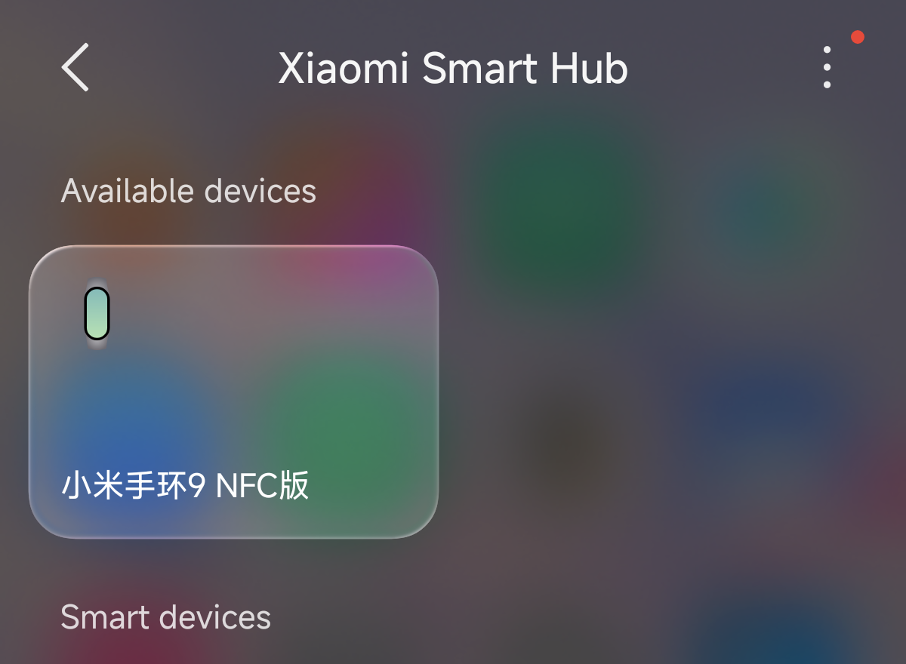

# 小米 14 融合设备中心与 Linux 所连 i5

**实测失败，停在卡片发现。** 2026-11-21 11:36（北京时间），Linux 正通过 i5 播放。小米 14 的融合设备中心在「可用设备」中只列出小米手环 9 NFC 版。页面未显示 i5 或持有它的电脑名称，也无法从原生卡片发出降噪命令。

| 核对项 | 观察 |
| --- | --- |
| 手机 | 小米 14（23127PN0CC），Android 17，HyperOS OS4.0.0.27.XNCCNXM。系统互联服务 com.milink.service 18.2.2.0.2609141543。OpenRose 0.0.0-dev+f5652f5，模块控制。 |
| 电脑 | cachyos-x8664，CachyOS，内核 7.3.3、BlueZ 5.88、PipeWire、niri 26.04。运行 OpenRose 0.0.0-dev+eb6a4a3。 |
| 流转配对和音频 | 两端已完成 OpenRose 局域网配对。ROSE EARFREE i5 多点关闭。Android 蓝牙服务显示该耳机的 ACL BR/EDR:N、LE:N；Linux 的两个 bearer 均已连接，i5 的 PipeWire 输出为 RUNNING，佩戴者确认听见来自 Linux 的双音测试声。 |
| OpenRose 快捷面板对照 | 之前的抗风噪已由手机 OpenRose 快捷面板切换为通透。打开融合设备中心时，Linux 托盘仍显示设备确认的通透、左耳 86%、右耳 88%、充电盒未知。 |
| 原生结果 | 系统页面为 Xiaomi Smart Hub（CirculateWorldActivity）。第一个分区 Available devices 只含手环，紧接着是 Smart devices。由于入口缺失，本次没有来自手机原生卡片的模式写入或回读。 |

截图保留系统页面标题、整个可用设备分区和下一分区标题。
